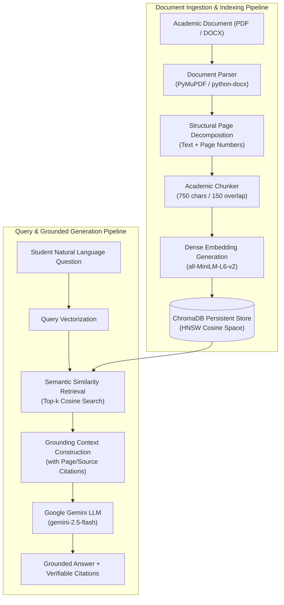

# A Retrieval-Augmented Generation Framework for Intelligent Question Answering in Academic Document Collections

[](https://fastapi.tiangolo.com)
[](https://react.dev)
[](https://tailwindcss.com)
[](https://www.trychroma.com)
[](https://aistudio.google.com)
[](LICENSE)

An online academic research assistant and question-answering web application powered by **Retrieval-Augmented Generation (RAG)**. The framework enables students and academic researchers to ingest peer-reviewed literature in **PDF** and **DOCX** formats, query the collection in natural language, and receive factually grounded answers with verified page-level source references.

---

## 1. Architectural Overview



---

## 2. Key Features

- **Multi-Format Academic Ingestion**:
  - Full-text extraction from **PDF** using **PyMuPDF (`fitz`)**, tracking exact physical page numbers.
  - Full-text and table extraction from Word **DOCX** files using **`python-docx`**.
- **Page-Aware Semantic Chunking**:
  - Recursive overlapping chunking (750-character window with 150-character overlap) preserving sentence boundaries and section coherence.
- **Dense Vector Indexing with ChromaDB**:
  - Sub-second vector similarity retrieval using 384-dimensional dense semantic embeddings (`all-MiniLM-L6-v2`).
  - Persistent HNSW index with cosine distance metric.
- **Strict Grounding & Zero Hallucination**:
  - Constrained context-conditioned prompt engineering directing Gemini to state *"Based on the uploaded documents, I could not find sufficient supporting information to answer this question"* whenever context lacks evidence.
  - Interactive source reference cards showing exact document title, page number, relevance match score, and excerpt snippets.
- **Multi-Document & Session Isolation**:
  - Session-isolated vector collections prevent cross-user document leakage.
  - Multi-document querying across all uploaded documents or selective filtering to specific manuscripts.
- **Modern Academic UI**:
  - Built with React, Tailwind CSS, and Lucide icons featuring glassmorphism, responsive desktop/mobile layouts, markdown rendering with code/table styling, and real-time upload progress visualizers.

---

## 3. Technology Stack

| Layer | Technologies |
| :--- | :--- |
| **Frontend** | React 18, Vite, Tailwind CSS, Lucide React, ReactMarkdown, Axios |
| **Backend** | Python 3.12, FastAPI, Uvicorn, Pydantic v2 |
| **LLM Provider** | Google Gemini API (`gemini-2.5-flash`, `gemini-1.5-flash`) |
| **Vector Database** | ChromaDB (Persistent client, HNSW Cosine Index) |
| **Embedding Engine**| Sentence Transformers / ChromaDB ONNX (`all-MiniLM-L6-v2`) |
| **Document Parsers**| PyMuPDF (`fitz`) for PDFs, `python-docx` for DOCX manuscripts |
| **Deployment** | Vercel (Frontend SPA), Render (Backend FastAPI + Persistent Disk) |

---

## 4. Repository Structure

```
├── backend/
│   ├── app/
│   │   ├── __init__.py
│   │   ├── main.py                # FastAPI entrypoint, CORS, routers & lifespan
│   │   ├── config.py              # Application settings via Pydantic & python-dotenv
│   │   ├── models/
│   │   │   ├── __init__.py
│   │   │   └── schemas.py         # Request/Response schemas (Pydantic v2)
│   │   ├── services/
│   │   │   ├── __init__.py
│   │   │   ├── document_parser.py # PyMuPDF & python-docx page extraction
│   │   │   ├── chunker.py         # Academic text chunking with overlap
│   │   │   ├── vector_store.py    # ChromaDB persistent client & CRUD operations
│   │   │   └── rag_engine.py      # Semantic search, context prompt & Gemini API
│   │   └── routers/
│   │       ├── __init__.py
│   │       ├── documents.py       # POST /upload, GET /documents, DELETE /{id}
│   │       └── chat.py            # POST /chat/ask, GET /chat/sample-questions
│   ├── sample_docs/               # Sample academic PDF and DOCX for testing
│   │   ├── sample_academic_paper.pdf
│   │   └── sample_research_proposal.docx
│   ├── tests/
│   │   ├── __init__.py
│   │   └── test_api.py            # Automated unit and integration tests
│   ├── create_sample_docs.py      # Generator script for academic sample docs
│   ├── Dockerfile                 # Container definition for cloud deployment
│   ├── render.yaml                # Render web service blueprint
│   ├── requirements.txt           # Python dependencies
│   └── .env.example               # Backend environment template
├── frontend/
│   ├── public/
│   │   └── favicon.svg            # Academic book icon
│   ├── src/
│   │   ├── components/
│   │   │   ├── Navbar.jsx         # Header with session, health pill & settings
│   │   │   ├── Sidebar.jsx        # Document management sidebar with delete & filter
│   │   │   ├── ChatArea.jsx       # Q&A conversation view, markdown & input
│   │   │   ├── FileUploadModal.jsx# Drag & drop upload modal with progress
│   │   │   ├── CitationCard.jsx   # Source reference card with snippet preview
│   │   │   ├── WelcomeHero.jsx    # Academic landing hero and sample questions
│   │   │   └── SettingsModal.jsx  # In-browser Gemini key & API URL settings
│   │   ├── services/
│   │   │   └── api.js             # Axios client with session tracking
│   │   ├── App.jsx                # Root state orchestration
│   │   ├── index.css              # Tailwind CSS imports & custom styling
│   │   └── main.jsx
│   ├── index.html                 # HTML entry with Google Fonts (Inter, Outfit)
│   ├── package.json
│   ├── vercel.json                # Vercel SPA routing rewrite configuration
│   └── .env.example
├── .gitignore
├── .env.example
└── README.md
```

---

## 5. REST API Specification

### General
- `GET /health` — Check backend readiness, Gemini configuration, and vector store status.
- `GET /` — API root overview and available endpoints.

### Documents
- `POST /documents/upload` — Upload an academic document (`multipart/form-data`: `file`, `session_id`).
  - Validates file type (`.pdf`, `.docx`) and file size (≤ 25MB).
  - Extracts text and page structures.
  - Splits text into overlapping segments, generates embeddings, and indexes into ChromaDB.
  - Returns `DocumentUploadResponse` with page count and chunk count.
- `GET /documents?session_id={session_id}` — List all indexed documents for the specified session.
- `DELETE /documents/{document_id}?session_id={session_id}` — Deletes document from catalog and purges all vector chunks from ChromaDB.

### Question Answering
- `POST /chat/ask` — Submit a question in natural language.
  - Body:
    ```json
    {
      "query": "What methodology did the authors use?",
      "session_id": "session_abc123",
      "document_ids": null,
      "api_key_override": null
    }
    ```
  - Response:
    ```json
    {
      "answer": "The authors utilized PyMuPDF for page-aware extraction...",
      "citations": [
        {
          "document_name": "sample_academic_paper.pdf",
          "document_id": "...",
          "page_number": 2,
          "chunk_id": "...",
          "snippet": "...",
          "relevance_score": 0.89
        }
      ],
      "session_id": "session_abc123",
      "query": "What methodology did the authors use?",
      "documents_queried": ["sample_academic_paper.pdf"],
      "is_grounded": true,
      "model_used": "gemini-2.5-flash"
    }
    ```
- `GET /chat/sample-questions` — Returns recommended academic questions for students.

---

## 6. Local Development Setup

### Prerequisites
- Python 3.10+ (tested on Python 3.12)
- Node.js 18+ (tested on Node.js v22)
- A Google Gemini API key ([free from Google AI Studio](https://aistudio.google.com/))

### 1. Backend Setup
```bash
# Navigate to backend directory
cd backend

# Create virtual environment
python -m venv venv

# Activate virtual environment
# Windows:
venv\Scripts\activate
# Linux/macOS:
source venv/bin/activate

# Install dependencies
pip install -r requirements.txt

# Configure environment variables
cp .env.example .env
# Edit .env and paste your GEMINI_API_KEY

# Start backend server
uvicorn app.main:app --host 0.0.0.0 --port 8000 --reload
```
The FastAPI interactive documentation will be available at [http://localhost:8000/docs](http://localhost:8000/docs).

### 2. Frontend Setup
```bash
# In a new terminal, navigate to frontend directory
cd frontend

# Install dependencies
npm install

# Start Vite dev server
npm run dev
```
Open your browser at [http://localhost:5173](http://localhost:5173).

---

## 7. Cloud Deployment Guide

### A. Deploying the Backend on Render
1. Push this repository to your GitHub account.
2. Sign in to [Render](https://render.com) and click **New + > Web Service**.
3. Select your repository.
4. Configure the Web Service:
   - **Name**: `academic-rag-backend`
   - **Root Directory**: `backend`
   - **Environment**: `Python 3`
   - **Build Command**: `pip install -r requirements.txt`
   - **Start Command**: `uvicorn app.main:app --host 0.0.0.0 --port $PORT`
5. Under **Environment Variables**, add:
   - `GEMINI_API_KEY`: *(Your Google Gemini API Key)*
   - `GEMINI_MODEL`: `gemini-2.5-flash`
   - `CHROMA_PERSIST_DIRECTORY`: `/opt/render/project/src/chroma_db`
   - `UPLOAD_DIRECTORY`: `/opt/render/project/src/uploads`
6. *(Optional for persistence)*: Under **Disks**, attach a 1GB Persistent Disk mounted to `/opt/render/project/src/chroma_db`.
7. Click **Create Web Service**. Note the deployed URL (e.g., `https://academic-rag-backend.onrender.com`).

### B. Deploying the Frontend on Vercel
1. Sign in to [Vercel](https://vercel.com) and click **Add New > Project**.
2. Import your GitHub repository.
3. Configure the project:
   - **Root Directory**: Select `frontend`
   - **Framework Preset**: `Vite`
   - **Build Command**: `npm run build`
   - **Output Directory**: `dist`
4. Under **Environment Variables**, add:
   - `VITE_API_BASE_URL`: `https://academic-rag-backend.onrender.com` *(your Render backend URL)*
5. Click **Deploy**. Vercel will build and provide a public URL (e.g., `https://academic-rag.vercel.app`).

*(Note: Users can also configure or override the backend URL directly in the web UI via the **Settings** modal at any time).*

---

## 8. Running Automated Tests

Run the test suite using `pytest`:
```bash
cd backend
pytest tests/ -v
```

---

## 9. Security & Document Isolation

- **Logical Session Isolation**: Every user session receives an isolated identifier. ChromaDB vector queries and catalog searches strictly filter chunks to the active session.
- **Backend Key Protection**: The Google Gemini API key resides strictly on the backend. Frontend requests never expose secrets.
- **Upload Validation**: File extension whitelisting (`.pdf`, `.docx`), payload size limits (25MB), and corruption checks protect the ingestion pipeline.

---

## 10. License

This project is licensed under the MIT License — see the [LICENSE](LICENSE) file for details.
